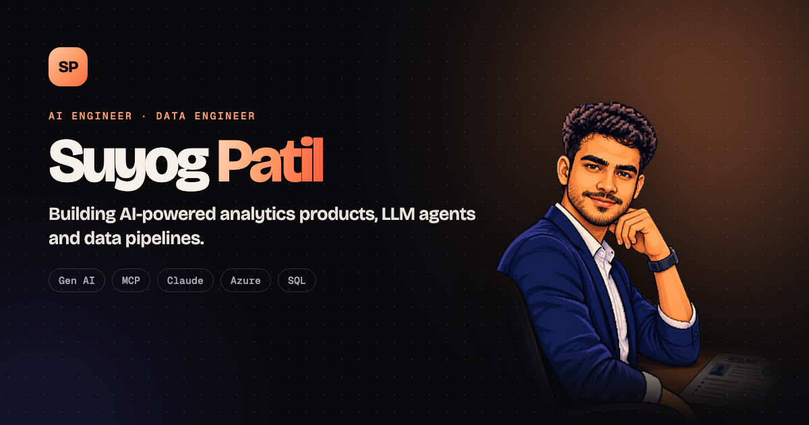

<div align="center">

# Suyog Patil · Portfolio

**AI Engineer · Gen AI Engineer · Data Scientist · Data Engineer**

Building AI-powered analytics products, LLM agents and data pipelines.

### 🌐 [suyogpatil395.github.io](https://suyogpatil395.github.io)



</div>

---

## ✨ What's inside

| Section | What it shows |
|---|---|
| **Hero** | Pixel-art portrait with live UI cards, a typed role line, and stat counters (400+ dashboards, 50+ clients, 4 AI assistants on one MCP connector, Analytics Studio v1.0 → v1.7) |
| **About · Education · Experience** | Background, degree, and a timeline of both roles with every highlight |
| **Project library** | Five featured projects as filterable cards; each cover is a live preview that plays on hover |
| **Case studies** | One page per project: an **animated, clickable architecture flow**, problem → solution, what I built, step-by-step process, results, a screenshot gallery with a lightbox, and the tech stack |
| **Skills · Certifications · Contact** | Tag clouds per skill area, certifications, and email / LinkedIn / GitHub / resume links |

**Featured projects (in order):** Azure Data Pipeline: Secure File Routing → Analytics Studio (AI Report Builder) → Rill Client Analytics Platform → Agentic Analytics Skills (MCP + Agent Skills) → Sigma Computing Analytics Platform.

## 🧱 How it's built

- **No framework, no dependencies.** `build.mjs` (plain Node) renders `content/site.mjs` into static HTML in `dist/`.
- **All copy lives in one file:** [`content/site.mjs`](content/site.mjs). Edit text there; never in templates.
- **Design system** shared with [suyogrow.in](https://suyogrow.in): dark + peach theme, Bricolage Grotesque / Plus Jakarta Sans / Geist Mono (self-hosted), with a light/dark toggle.
- **Interactions** in one small script ([`src/app.js`](src/app.js)): theme toggle, scroll reveals, count-ups, typed roles, project filters, hover-to-play GIF covers, the flow player (auto-play when visible, click a step, ← → keys), and the image lightbox.
- **Accessible and fast:** respects `prefers-reduced-motion`, keyboard friendly, semantic landmarks, and cross-document view transitions when opening a case study.
- **SEO:** per-page titles and descriptions, Open Graph and Twitter cards, JSON-LD `Person`, `sitemap.xml`, `robots.txt`, and an "SP" favicon.
- **Privacy guard:** the build fails if a banned name or a phone number ever appears in the site's pages.

Lighthouse (mobile): **95+ in Performance, 100 in Accessibility, 100 in Best Practices, 100 in SEO** on every page.

## 🗂️ Structure

```text
content/site.mjs        # ALL site copy: hero, about, experience, skills, projects + flows
build.mjs               # static site generator → dist/
src/styles.css          # design system + components
src/app.js              # interactions (no dependencies)
src/fonts.css           # self-hosted @font-face
src/icons.json          # inline SVG icons (Font Awesome Free, CC BY 4.0) + GitHub mark
static/                 # fonts, images, project media, resume.pdf, favicons, og.png
.github/workflows/      # build + deploy to GitHub Pages on push to main
```

## ▶️ Run locally

```bash
npm run dev        # builds and serves dist/ at http://localhost:4321
# or
node build.mjs     # just build
```

## 🚀 Deploy

Push to `main`. GitHub Actions runs `node build.mjs` and publishes `dist/` to GitHub Pages.

To update the resume, replace `static/resume.pdf` and push.

---

## 👤 Author

<div align="center">

**Suyog Patil**

*Data Engineer · Portfolio · Vanilla JS · Static Site Generator · Generative AI*

[](https://www.linkedin.com/in/suyog-patil-0089241b2/)
[](https://github.com/suyogpatil395)

⭐ If this portfolio template helped you build your own, consider starring the repo.

</div>
